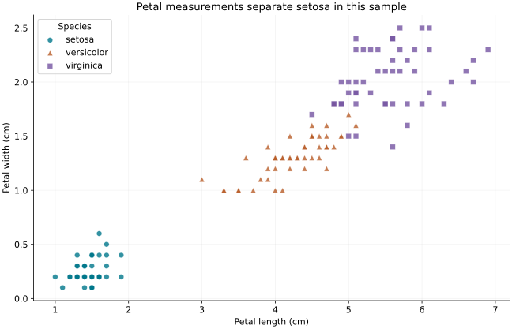
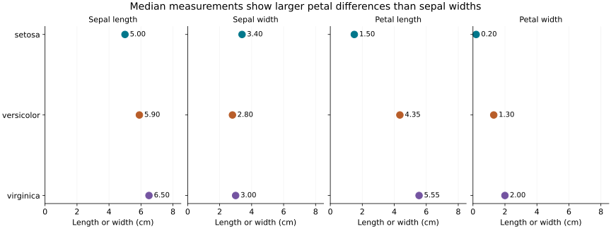

# Iris measurements: an exploratory data science project

## Research question
How do petal measurements and median flower measurements differ between the three Iris species in this historical sample?

## Data source and permissions
150 observations from UCI's Iris dataset, 50 per species. All measurements are in centimetres. Data are licensed CC BY 4.0, permitting redistribution and adaptation with attribution. See [data/SOURCE.md](data/SOURCE.md) for the original download, license and documented historical data discrepancies. No private or personal records are used.

Fisher, R. (1936). *Iris* [Dataset]. UCI Machine Learning Repository. https://doi.org/10.24432/C56C76

## Methods and tools
Python, pandas, NumPy and Matplotlib. The script validates row counts, missingness and positive measurements, audits duplicate rows without automatically removing them, computes grouped medians and ranges, and renders two SVG visualizations. This is descriptive analysis; it does not train or evaluate a classifier.

## Findings
- Setosa petal lengths range from 1.0 to 1.9 cm; the other two species start at 3.0 cm in this sample.
- Median petal lengths are 1.50, 4.35 and 5.55 cm for setosa, versicolor and virginica respectively.
- Versicolor and virginica overlap in petal measurements. A visually distinct cluster is not a measured predictive accuracy.


Each point is one observation; colors and shapes distinguish species. Overlapping points can hide repeated measurements.


The panels share a zero-based centimetre scale. Labels state group medians; they do not show individual variation.

## Limitation
This small historical, balanced sample is not an independent evaluation of modern field identification. Its sampling frame and the UCI-documented historical value discrepancies limit generalization. Duplicate measurement rows may represent different flowers, so they are audited and retained. Group medians conceal variation.

## Reproduce the analysis
Install Python 3.10 or newer. From this repository's root:
```bash
python -m venv .venv
# Windows: .venv\Scripts\activate
# macOS/Linux: source .venv/bin/activate
python -m pip install -r requirements.txt
python analysis.py
```
No network access is needed after installing dependencies: the attributed input CSV is included. This regenerates both figures and the results tables. Exact tested package versions and a source-data SHA-256 are recorded in results/summary.json. SVG rendering may differ between library versions; numerical summaries should agree.

## Status
Completed descriptive analysis. Next steps are an independent dataset, a documented split and cross-validated classification, if a predictive question is pursued. Peer review of the portfolio is a separate course requirement and is not claimed here.

## Code license
Original analysis code is released under the MIT license. The source data retain their separate CC BY 4.0 license.
